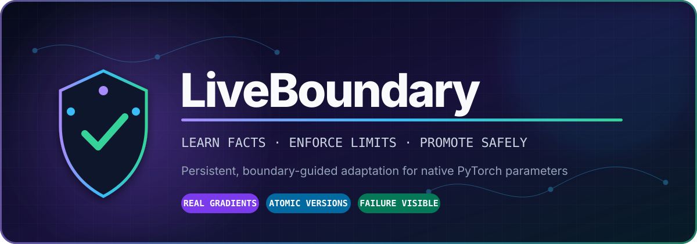
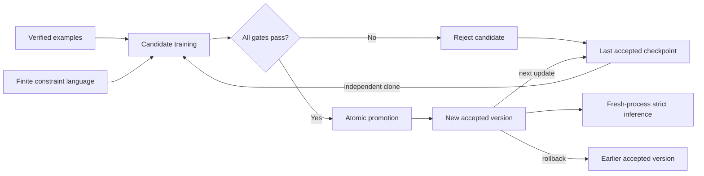

<div align="center">



<br />

[](https://github.com/oasb16/LiveBoundary/actions/workflows/ci.yml)
[](https://github.com/oasb16/LiveBoundary/releases/latest)
[](https://www.python.org/)
[](https://pytorch.org/)
[](LICENSE)
[](https://github.com/oasb16/LiveBoundary/stargazers)

**Persistent, boundary-guided online adaptation for native PyTorch parameters.**

Learn verified facts. Enforce explicit constraints. Reject unsafe candidates. Survive a fresh process.

[⚡ Run it](#-60-second-demo) · [🧠 How it works](#-the-adaptation-loop) · [📊 See the evidence](#-the-honest-benchmark) · [🧪 Explore the API](#-api-tour) · [🧭 Read the limits](#-what-this-does-not-claim)

</div>

---

## The idea in one screen

Most AI "memory" systems keep the model frozen and place retrieved text into its runtime context.
LiveBoundary explores a different question:

> **Can a model absorb verified facts into its own parameters while explicit operating boundaries decide whether the update is safe enough to keep?**

```text
verified examples ──┐
                    ├──▶ clone accepted model ──▶ gradient update ──▶ candidate
explicit boundaries ┘                                              │
                                                                   ▼
                  ┌──────────── reject ◀── evaluation gates ── pass?
                  │                                                │
                  │                                                ▼
                  └── accepted model unchanged        atomic checkpoint + promotion
                                                                      │
                                                                      ▼
                                                        fresh-process inference
```

This is not a prompt wrapper. The model's native tensors change through real gradients. A candidate
must then pass new-knowledge, retention, correction, boundary, usefulness, stability, and finiteness
checks before it becomes the accepted version.

## 🔥 Why this is interesting

| Runtime memory / retrieval | LiveBoundary |
| --- | --- |
| Model weights stay frozen | Selected native parameters are updated |
| Facts are supplied again at inference | Strict inference receives only a checkpoint and question |
| Bad context can affect the current response | Bad candidates can be rejected before promotion |
| History is usually external | Each business gets an independent accepted-version lineage |
| Rollback means changing a database or index | Rollback moves the accepted checkpoint pointer |

LiveBoundary deliberately makes failure visible. If an update learns a new fact but destroys prior
knowledge, it can be rejected. If a set of active constraints has no valid output, training stops
with the rule identifiers that caused the contradiction.

## ⚡ 60-second demo

```bash
git clone https://github.com/oasb16/LiveBoundary.git
cd LiveBoundary
python3 -m venv .venv
source .venv/bin/activate
python -m pip install -e '.[dev]'
python examples/quickstart.py
```

Expected shape of the output:

```text
accepted: True
changed native parameters: [...]
prediction: ...
fresh process: ...
```

Then run the full verification suite:

```bash
pytest
ruff check .
```

No hosted service, API key, database, or network connection is required after installation.

## 🧠 The adaptation loop



The lifecycle is intentionally transactional:

1. **Clone** the last accepted model. The live accepted model is not trained in place.
2. **Adapt** selected parameters using verified-task loss, exact boundary loss, optional preservation,
   and bounded replay.
3. **Evaluate** the candidate on independent suites and explicit thresholds.
4. **Reject or promote**. Rejection leaves the accepted model untouched. Promotion uses an atomic
   checkpoint and manifest replacement.
5. **Restart cleanly**. Strict inference launches a new process with exactly two inputs: the accepted
   checkpoint and one structured question.

Read the complete state model in [the architecture guide](docs/architecture.md).

## 🛡️ Boundaries are executable, not decorative

Policies are represented with a closed, inspectable constraint language:

```python
constraint = Constraint(
    constraint_id="settled-no-collection",
    version="1",
    description="Settled accounts must not receive collection action",
    expression=Not(CategoryIn(["collect"])).to_dict(),
    condition={
        "op": "field",
        "field": "status",
        "cmp": "eq",
        "value": "settled",
    },
)
```

Supported composition includes:

```text
CategoryIn · Not · AllOf · AnyOf · Implies · trusted-field conditions
```

For an active rule with valid output set `V`, LiveBoundary minimizes the exact satisfaction-mass loss:

```text
-log P(Y in V) = logsumexp(all logits) - logsumexp(logits in V)
```

Every output is enumerated up to a configurable cap. An empty valid set raises
`UnsatisfiableConstraints` instead of silently training on an impossible policy.

## 📊 The honest benchmark

Measured locally on macOS with Python 3.9.6, PyTorch 2.8.0, three fixed seeds, 100 baseline
pretraining steps, and 80 adaptation steps. All data are synthetic.

| Strategy | New facts | Prior retention | Stable behavior | Accepted updates |
| :--- | ---: | ---: | ---: | ---: |
| 🧊 Frozen baseline | `0.056` | `1.000` | `1.000` | N/A |
| ⚡ Task only | **`1.000`** | `0.000` | `0.833` | `2/3` |
| 🛡️ Boundary guided | **`1.000`** | `0.000` | `0.833` | `2/3` |
| 🧬 Boundary + preservation/replay | `0.944` | **`1.000`** | **`1.000`** | **`3/3`** |

The result is not a victory lap. It exposes the actual tradeoff:

- Task-only and boundary-only adaptation learned the new facts but catastrophically forgot the two
  prior probes.
- The stability gate rejected one regressed candidate instead of corrupting the accepted lineage.
- Preservation plus replay retained prior and stable behavior across all three seeds, but still missed
  one new/useful example at seed 41.

Reproduce it:

```bash
liveboundary-benchmark --seeds 3,17,41 --output benchmark-results.json
```

Inspect the [analysis](RESULTS.md) and the complete
[raw per-seed records](benchmark-results.json), including rejected candidates, latency, bounded step
budgets, and checkpoint sizes.

## 🧪 API tour

```python
from liveboundary import BusinessLearner

learner = BusinessLearner(
    business_id="acme",
    model=model,
    baseline=baseline,
    constraints=constraints,
    config=config,
    checkpoint_dir=checkpoint_dir,
)

# Train an isolated candidate and promote it only if every gate passes.
report = learner.adapt(verified_batch, validation_suite)

# Predict from the currently accepted in-process version.
result = learner.predict(query)

# Prove the answer survives without replay, training context, or retrieval.
strict_result = learner.strict_predict(query)

# Move the accepted pointer to an earlier known-good version.
learner.rollback(version_id)
```

The complete executable example is in [`examples/quickstart.py`](examples/quickstart.py).

### Optional local causal-LM adapter

```bash
python -m pip install -e '.[hf]'
```

`LocalCausalLMAdapter` loads the model and tokenizer with `local_files_only=True` and scores a declared
set of answer candidates. Its softmax is over those candidates, not the full language distribution.
It is an integration preview and is not yet part of transactional persistence or the benchmark.

## 🧬 What gets persisted

Each accepted model version records:

| Provenance | Model identity | Transaction state |
| --- | --- | --- |
| Parent version | Architecture identity | Checkpoint path |
| Configuration hash | Baseline SHA-256 | Adaptation metadata |
| Constraint hash | Selected parameters | Accepted manifest pointer |
| Random seed | Parameter and buffer state | Business-scoped lineage |

The immutable baseline remains a recovery point. It is never treated as the source of truth for newly
verified facts.

## 💥 Failure is a first-class result

LiveBoundary fails closed for the conditions it explicitly checks:

- cross-business examples
- train/final-test identifier overlap
- unsatisfiable active constraints
- non-finite loss, gradients, or parameters
- retention, correction, usefulness, boundary, or stability gate failures
- mutated baseline weights or buffers
- candidate/accepted tensor storage aliasing
- unknown rollback versions
- malformed strict-inference payloads

This is a research mechanism, not a claim that these checks cover every production failure mode.

## 🗺️ Repository map

```text
LiveBoundary/
├── src/liveboundary/
│   ├── learner.py          # candidate training, evaluation, promotion, rollback
│   ├── constraints.py      # finite rule language and exact boundary loss
│   ├── checkpoints.py      # atomic checkpoints and accepted-version manifest
│   ├── models.py           # tiny adapter and optional local causal-LM adapter
│   ├── contracts.py        # typed data and configuration contracts
│   └── strict_inference.py # fresh-process inference boundary
├── examples/quickstart.py  # smallest complete demonstration
├── tests/                  # constraints, learning, persistence, events, splits
├── docs/                   # architecture, contracts, related work
├── RESULTS.md              # benchmark interpretation
└── benchmark-results.json  # raw reproducible evidence
```

## 🚧 What this does not claim

LiveBoundary demonstrates native-weight adaptation on a tiny structured classifier. It does **not**
establish:

- frontier-model effectiveness
- production database or distributed-systems reliability
- autonomous lifelong learning
- a natural-language policy compiler
- generic policy satisfaction guarantees
- guaranteed deletion or machine unlearning
- tenant authorization through parameter isolation
- safe reversal of actions already taken in external systems

The optional language-model adapter is unbenchmarked here. The term “anti-training” is informal
motivation, not a new learning algorithm. Read every caveat in [`LIMITATIONS.md`](LIMITATIONS.md).

## 🌌 Research directions

- Scaling exact or approximate constraint scoring beyond finite output spaces
- Adversarial, counterfactual, and distribution-shift evaluation
- Privacy-aware replay and retention controls
- Optimizer-state continuity without hidden mutation
- Temporal facts, corrections, and edit locality
- Stronger probe coverage and human-governed verification
- Transactional persistence for local language-model adapters

If one of these is your area, open an issue with an experiment proposal.

## 🤝 Contributing

Bug reports, adversarial tests, failure cases, benchmark extensions, and carefully scoped adapters are
welcome. Please read [`CONTRIBUTING.md`](CONTRIBUTING.md) before opening a pull request.

```bash
git clone https://github.com/oasb16/LiveBoundary.git
cd LiveBoundary
python3 -m venv .venv
source .venv/bin/activate
python -m pip install -e '.[dev]'
pytest
ruff check .
```

<div align="center">

### Models should be allowed to learn. Unsafe updates should not be allowed to become history.

⭐ Star the repository if you want to follow the experiment.

[Open an issue](https://github.com/oasb16/LiveBoundary/issues/new) · [Read the architecture](docs/architecture.md) · [Inspect raw results](benchmark-results.json) · [Download the latest release](https://github.com/oasb16/LiveBoundary/releases/latest)

Apache-2.0 licensed. Original implementation. No hosted dependency.

</div>
